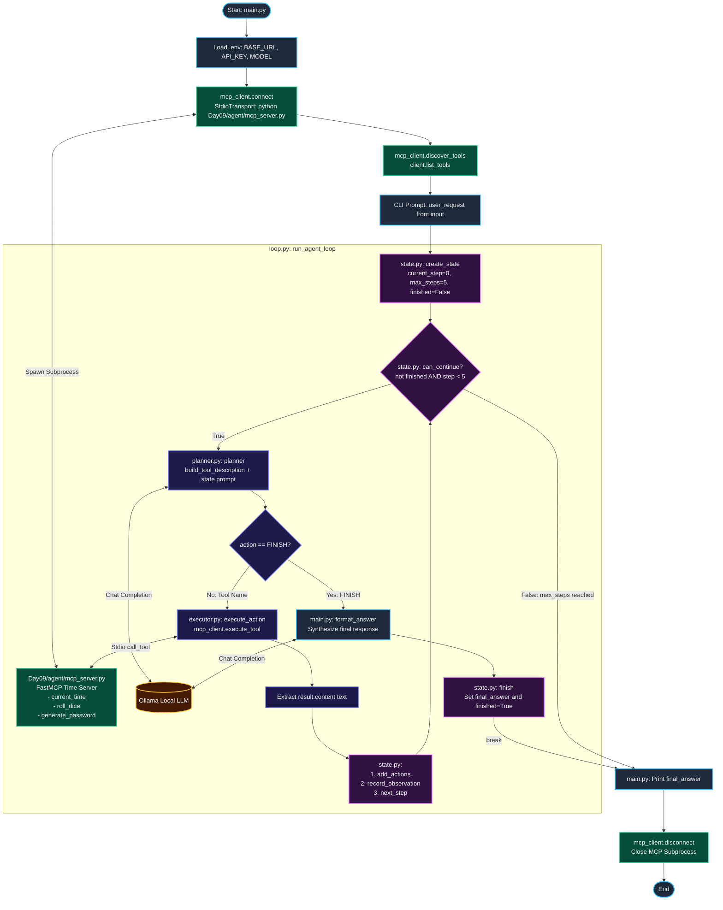

# First Python AI Agent (FastMCP + Ollama)

A modular, local-first autonomous AI agent built in Python using a **Plan–Execute–Observe** control loop, **FastMCP** over `StdioTransport` for tool isolation, and a local **Ollama** LLM (via the OpenAI-compatible Python SDK).

---

## Architecture & Execution Flow



---

## Project Structure

```text
firstpythonaiagent/
├── agent/
│   ├── main.py          # CLI entry point, .env loader, MCP lifecycle & answer synthesis
│   ├── loop.py          # Core async Plan–Execute–Observe loop
│   ├── planner.py       # Prompts Ollama to select the next tool or return FINISH
│   ├── executor.py      # Dispatches tool calls to MCP client & parses TextContent
│   ├── state.py         # State dictionary factory, step tracking & max_steps guard
│   └── mcp_client.py    # FastMCP StdioTransport client wrapper
|   └── mcp_server.py    # FastMCP ("Time Server") exposing @mcp.tool() endpoints
```

### Available MCP Tools (`Day09/agent/mcp_server.py`)
| Tool Name | Description |
| :--- | :--- |
| `current_time` | Returns the current local date and time (`YYYY-MM-DD HH:MM:SS`). |
| `roll_dice` | Simulates rolling a six-sided die (`1`–`6`). |
| `generate_password` | Generates a cryptographically random password (default length: `12`). |

---

## Prerequisites & Setup

1. **Install Ollama** and pull a local chat model (e.g., `llama3.2` or `qwen2.5`):
   ```bash
   ollama pull llama3.2
   ```

2. **Install Python dependencies**:
   ```bash
   pip install fastmcp openai python-dotenv
   ```

3. **Configure environment variables**:
   Create a `.env` file in the directory where you run `main.py`:
   ```env
   BASE_URL=http://localhost:11434/v1
   API_KEY=ollama
   MODEL=llama3.2
   ```

---

## Usage

Run the agent from the repository root so `StdioTransport` resolves `Day09/agent/mcp_server.py`:

```bash
python agent/main.py
```

### Example Session
```text
Connected to MCP server.

Available Tools
===============
current_time
roll
